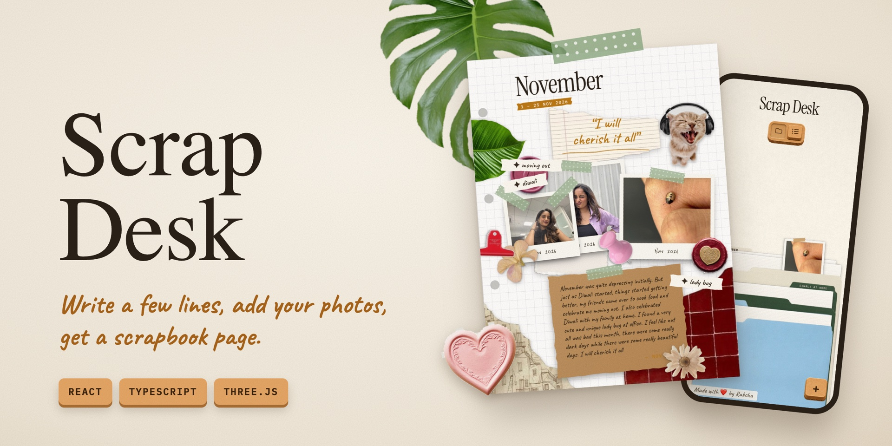
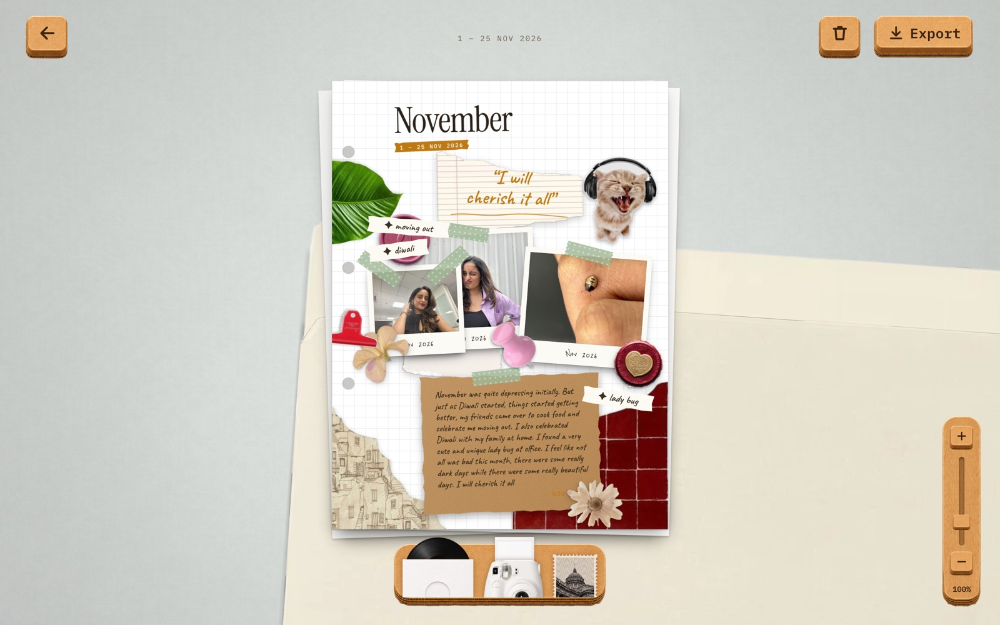
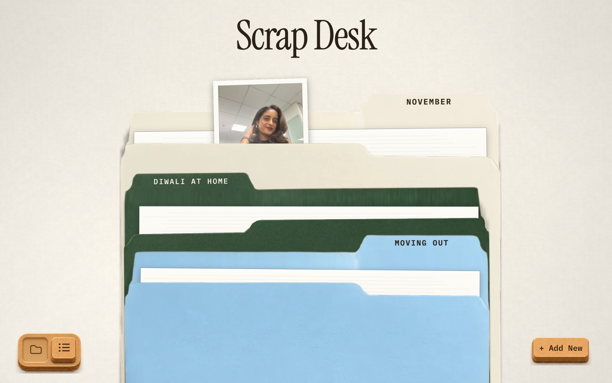
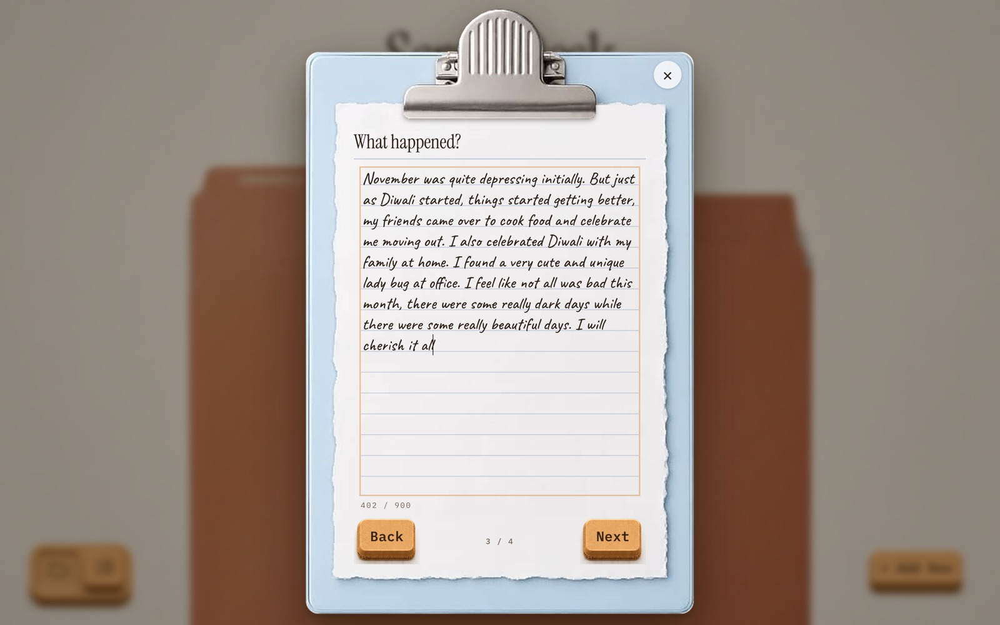
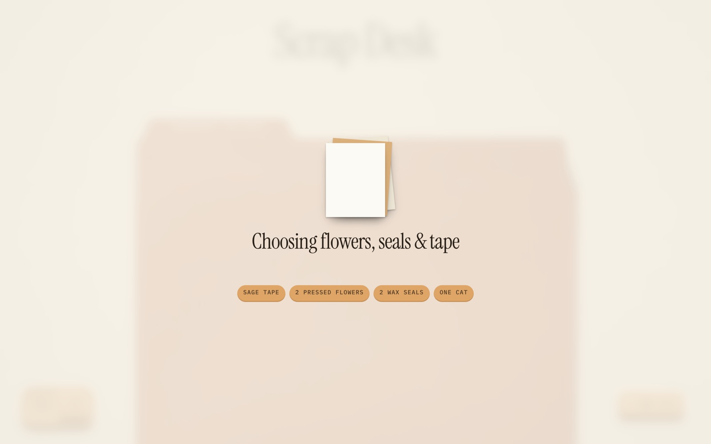
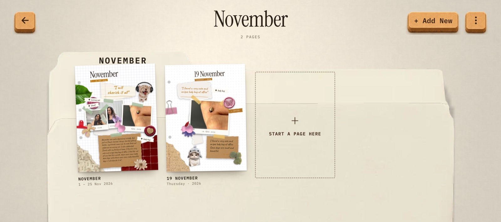
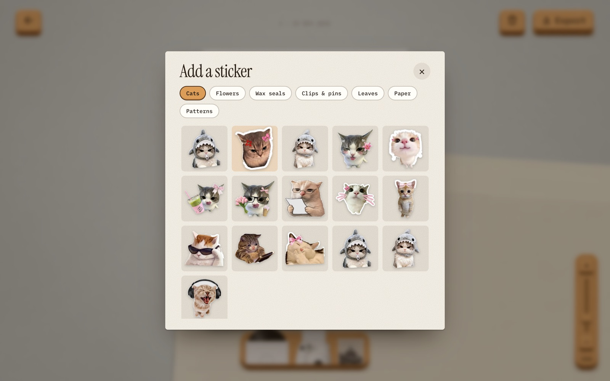
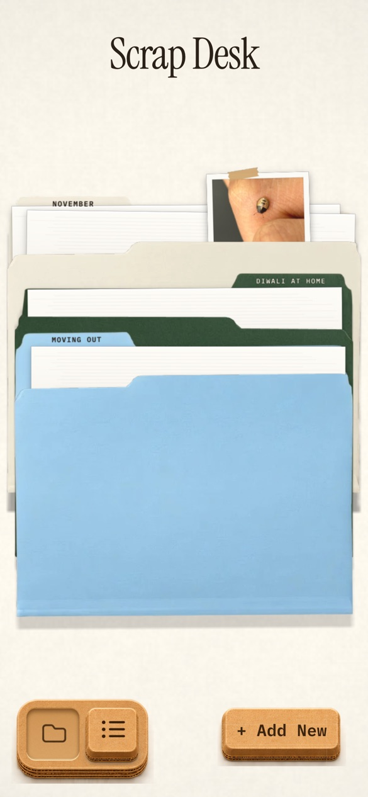
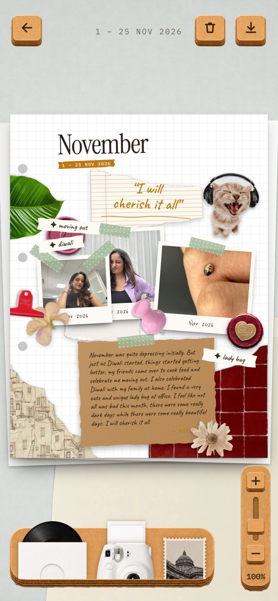
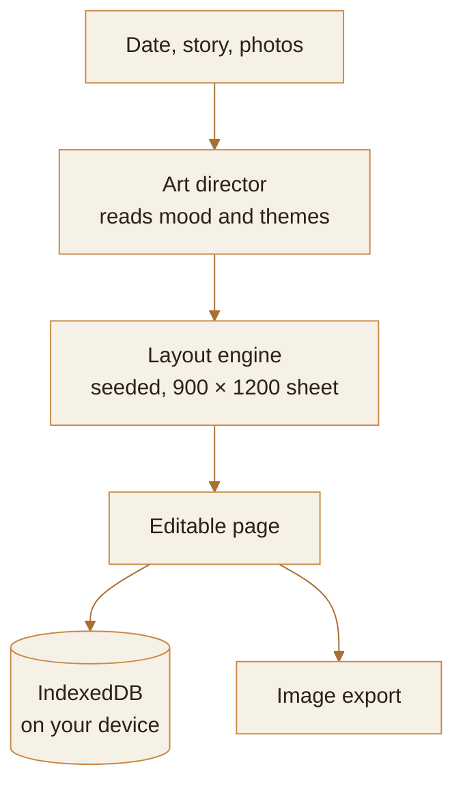

<p align="center">
  <a href="https://scrap-desk-gamma.vercel.app">
    
  </a>
</p>

<h1 align="center">Scrap Desk</h1>

<p align="center">
  <b>A digital junk journal.</b><br>
  Pick a date, write a few lines, add up to six photos, and get a scrapbook page you can rearrange and keep.
</p>

<p align="center">
  <a href="https://scrap-desk-gamma.vercel.app"></a>
</p>

<p align="center">
  <a href="https://github.com/raksha-s/scrap-desk/actions/workflows/ci.yml"></a>
  
  
  
  
</p>

---

## The idea

Junk journals are lovely and slow. Scrap Desk keeps the feel (torn paper, wax seals, pressed flowers, tape that never sits quite straight) and does the arranging for you. You tell it what happened; it reads the mood and lays out a page.

## A sample page

> *"November was quite depressing initially. But just as Diwali started, things started getting better, my friends came over to cook food and celebrate me moving out. I also celebrated Diwali with my family at home. I found a very cute and unique lady bug at office. I feel like not all was bad this month, there were some really dark days while there were some really beautiful days. I will cherish it all"*

That story and three photos went in. This came out, with the pull quote and the *diwali*, *moving out* and *lady bug* labels picked from the text.

<p align="center">
  
</p>

## Walk through it

<table>
  <tr>
    <td width="50%"></td>
    <td width="50%"></td>
  </tr>
  <tr>
    <td align="center"><b>The desk</b><br>A 3D stack of folders you scroll through</td>
    <td align="center"><b>The writing pad</b><br>One question per sheet</td>
  </tr>
  <tr>
    <td></td>
    <td></td>
  </tr>
  <tr>
    <td align="center"><b>Making the page</b><br>It reads the story and picks the pieces</td>
    <td align="center"><b>Inside a folder</b><br>Every page, kept together</td>
  </tr>
</table>

<p align="center">
  <br>
  <b>The sticker drawer</b>: cats, flowers, wax seals, clips, leaves, paper and patterns
</p>

### On a phone

<p align="center">
  
  &nbsp;&nbsp;&nbsp;
  
</p>

## What it does

| Feature | What you get |
|---|---|
| **Folders** | Create, rename, recolour (11 colours) and delete, as a 3D stack or a list |
| **Pages** | One date or a range, a story up to 900 characters, up to six photos |
| **Editing** | Drag, rotate, resize, bring to front, delete, and zoom |
| **Photo frames** | Polaroid, Instax, film strip, kraft mat, rounded, torn edge |
| **Extras** | Sticker drawer, in-browser camera, album covers for the music of the moment |
| **Export** | Save any page as an image |
| **Sound** | Paper and key sounds synthesised with Web Audio, so there are no audio files |
| **Motion** | Respects your reduced-motion setting |

## How a page gets made



- **Art director** ([`director.ts`](app/src/engine/director.ts)): rules, not a model. It finds where the story turns (*"but just as…"*), scores the mood on each side, and chooses papers, colours and decorations to match. It sits behind an interface so an AI director can be added alongside it.
- **Layout engine** ([`layout.ts`](app/src/engine/layout.ts)): deterministic and seeded. Text blocks are placed to stay readable; decorations may tuck under and over corners.
- **Storage** ([`repo.ts`](app/src/storage/repo.ts)): the only code that touches IndexedDB.

## Privacy

There is no account and no server holding your journals. Pages and photos stay in your browser, on your device. The one outside request is the album-cover search (MusicBrainz, Cover Art Archive and iTunes).

That also means clearing site data erases your journals, so export the pages you want to keep.

## Run it yourself

Needs Node 20.19 or newer.

```bash
git clone https://github.com/raksha-s/scrap-desk.git
cd scrap-desk/app
npm install
npm run dev
```

Then open http://localhost:5191. `npm test` runs the test suite and `npm run build` makes the static site. More detail is in [`app/README.md`](app/README.md).

## Project layout

```text
app/         the web app (React, TypeScript, Vite, Three.js)
prototype/   the first look-and-feel prototype the app was ported from
docs/        design specs, build plan and screenshots
```

## What's next

- An AI art director that can look at the photos and write captions
- Backup and sync
- Editing a page's date and story after it is made

## About the art

The stickers, papers, stamps, folders and other artwork are included so the app works as designed. **They are not offered for reuse**; rights stay with their respective owners. This repository does not currently carry an open-source license.

---

<p align="center"><i>"I feel like not all was bad this month. I will cherish it all."</i></p>

<p align="center">Made with ❤️ by Raksha</p>
